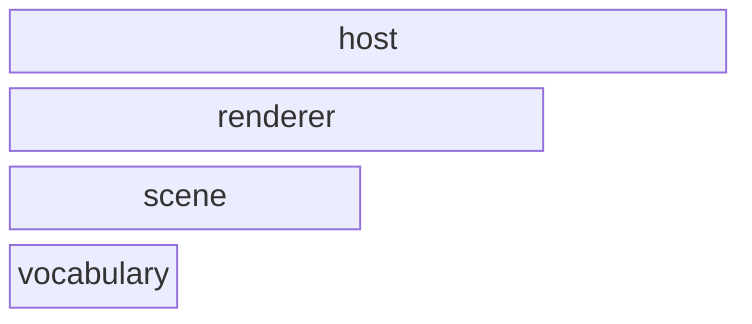
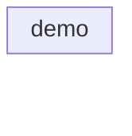
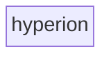
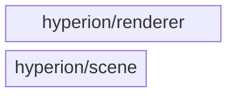

# Architecture

The checked-in architecture contract for Hyperion (the check-arch reflexion
gate). The root vocabulary (`hyperion/ShaderPaths.hpp`), the scene leaf, the
renderer consuming it, and the thin `demo` host on top. **Hyperion never
depends on Theia** — the sibling renderers are independent; shared code goes
down into Harmonia (a `theia/` include is a hard violation).

<!-- check_arch: diagram BEGIN -->
### the layers



### layer host - the modules



### layer vocabulary - the modules



### hyperion - the nested modules


<!-- check_arch: diagram END -->

## The machine contract

```arch
scan: src
extensions: .hpp, .cpp
exclude: build, _deps, .git
unclassified: error
external: SDL3, harmonia, slang-math, vma, volk
forbidden: theia
quotes_relative: true
repo_fallback: false
cycles: true
namespace_root:
namespace_module:
namespace_require:
unresolved: info
within_layer: deny              # undeclared same-layer edges: violations
header_size: warn                # the standing bloat rule (promote to error when the queue is drained)
smells: report                 # refactoring-catalog proxies: report-only review signals

layer vocabulary
layer scene
layer renderer
layer host

module hyperion in vocabulary
module hyperion/scene in scene
module hyperion/renderer in renderer
module demo in host

allow hyperion/scene -> hyperion
allow hyperion/renderer -> hyperion
allow hyperion/renderer -> hyperion/scene
allow demo -> hyperion
allow demo -> hyperion/scene
allow demo -> hyperion/renderer
```
