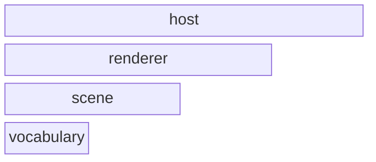
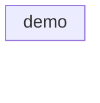
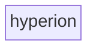
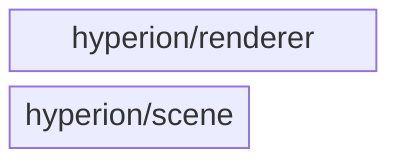

# Architecture

Hyperion's own code is small and sits on top of two libraries (Harmonia and, through it,
Aether). It is organized in four layers. Each layer depends only on the layers below it:

| Layer (top to bottom) | Module | Directory | Content |
|-----------------------|--------|-----------|---------|
| host | `demo` | `src/demo/` | The executable: `Application`, the subclass of Harmonia's application host that wires scene, camera and animation to the renderer, and `main.cpp` |
| renderer | `hyperion/renderer` | `src/hyperion/renderer/` | `PathTracer` (per-frame recording), `ShaderBindingTable`, `SamplingPlan` |
| scene | `hyperion/scene` | `src/hyperion/scene/` | `Scene`: the GPU scene layout for ray tracing and the top-level acceleration structure |
| vocabulary | `hyperion` | `src/hyperion/ShaderPaths.hpp` | The shader file names that the other modules share |

The rules:

- An include may point downwards only: the demo may include every other module, the renderer
  may include the scene and the vocabulary, and the scene may include the vocabulary. An
  include upwards, or between two modules without an `allow` line, is a violation.
- Includes of Harmonia, Aether, slang-math, SDL3, VMA and volk are external and always allowed.
- Hyperion never depends on Theia. The two renderers are siblings; code that both of them need
  moves down into Harmonia. An include of a `theia/` path is a violation.
- Files must not include each other in a cycle.

The diagrams below are generated from the contract and show the drill-down: the layer stack,
each layer's modules, and the nested modules.

<!-- check_arch: diagram BEGIN -->
### the layers



### layer host - the modules



### layer vocabulary - the modules



### hyperion - the nested modules


<!-- check_arch: diagram END -->

## The machine contract

```arch
scan: src
extensions: .hpp, .cpp
exclude: build, _deps, .git
unclassified: error
external: SDL3, aether, harmonia, slang-math, vma, volk
forbidden: theia
quotes_relative: true
repo_fallback: false
cycles: true
namespace_root:
namespace_module:
namespace_require:
unresolved: info
within_layer: deny              # undeclared same-layer edges: violations
header_size: error               # the standing bloat rule (hard gate)
smells: report                 # refactoring-catalog proxies: report-only review signals

layer vocabulary
layer scene
layer renderer
layer host

module hyperion in vocabulary
module hyperion/scene in scene
module hyperion/renderer in renderer
module demo in host

allow hyperion/scene -> hyperion
allow hyperion/renderer -> hyperion
allow hyperion/renderer -> hyperion/scene
allow demo -> hyperion
allow demo -> hyperion/scene
allow demo -> hyperion/renderer
```

## Reading the contract

The `arch` block is the whole contract. It is parsed line by line, and `#` starts a comment.

| Entry | Meaning |
|-------|---------|
| `scan: src` | Every `.hpp` and `.cpp` file below `src/` belongs to the contract. |
| `exclude: build, _deps, .git` | Directories that are never scanned. |
| `unclassified: error` | A scanned file that lies in no declared module fails the check. |
| `external: …` | Include roots owned by other repositories (`SDL3`, `aether`, `harmonia`, `slang-math`, `vma`, `volk`). They are counted and reported, never reported as violations. |
| `forbidden: theia` | An include whose path starts with `theia` is a violation. |
| `quotes_relative: true`, `repo_fallback: false` | A quoted include resolves relative to the file that contains it, not against the repository root. |
| `unresolved: info` | A quoted include that resolves to nothing is reported for information only. |
| `within_layer: deny` | An undeclared include between two modules of the same layer is a violation. |
| `cycles: true` | Include cycles between files are violations. |
| `header_size: error` | A scanned file of 1000 lines or more is a violation. |
| `smells: report` | Refactoring smell proxies (orphan, hub, pass-through and large modules) are listed with `--report` or `--json` only; they never fail the check. |
| `layer <name>` | Declares a layer. The declaration order is the stack, bottom first. |
| `module <path> in <layer>` | Assigns a directory to a layer. |
| `allow <consumer> -> <provider>` | Permits an include between two modules. Anything not permitted is denied. |

In this contract the stack is, bottom first: `vocabulary`, `scene`, `renderer`, `host`. The four
modules are `hyperion` (the vocabulary), `hyperion/scene`, `hyperion/renderer` and `demo`. The
six `allow` lines permit exactly the downward edges.

## Running the check

```powershell
python tools/check_arch.py --repo . --doc ARCHITECTURE.md
```

ctest runs the same command as `test_arch` (label `analysis`) where the check-arch engine is
installed in the user profile.

| Output | Meaning |
|--------|---------|
| `architecture clean (…)` | The include graph matches the contract. The line names what was checked: number of files, distinct module edges, cycles, layer stack. |
| `<module> must not include <module> (xN; edge not declared)` | An include that no `allow` line permits. |
| `<module> (layer X) must not depend on <module> (layer Y)` | A declared edge that runs against the stack. |
| `unclassified module: <file>` | A file outside every declared module. |
| `must not include "…" (forbidden dependency)` | An include of a forbidden path. |
| `include cycle: a.hpp <-> b.hpp` | Files that include each other directly or indirectly. |
| `DIAGRAM DRIFT` | The diagram section no longer matches the rules; regenerate it. |
| `HEADER SIZE: <file>` | A file that reached the line limit. |

Exit codes: 0 clean, 1 violations, 2 contract or usage error (an unknown or duplicate knob, an
edge to a module that is not declared, a missing block), 77 nothing to scan.

`--report` also prints the layer stack, the declared edges and every measured edge; `--json`
prints the same information as JSON.

## Changing the structure

| Change | What to do |
|--------|------------|
| A new file inside an existing module directory | Nothing; the contract covers it. |
| A new directory below `src/` | Declare it with a `module` line in its layer and add an `allow` line for every module that includes it. Until then the check reports an unclassified module. |
| A new permitted dependency | Add an `allow <consumer> -> <provider>` line. It must respect the layer order: an edge from a lower to a higher layer is a violation even when it is declared. |
| A change to the layers, modules or edges | Regenerate the diagram section with `python tools/check_arch.py --diagram`. A stale diagram is reported as diagram drift. |

The diagram section between the two `check_arch` markers and the `arch` block are the only
machine-read parts of this document. Everything else is prose.

## Build targets mirror the layers

`CMakeLists.txt` expresses the same dependency direction with link targets, so an include
against the direction also fails at link time.

| CMake target | Module | Links |
|--------------|--------|-------|
| `hyperion_vocab` (interface) | `hyperion` | Harmonia |
| `hyperion_scene` (static library) | `hyperion/scene` | Harmonia |
| `hyperion_renderer` (static library, alias `hyperion_lib`) | `hyperion/renderer` | `hyperion_scene`, Harmonia |
| `hyperion_demo` (static library) | `demo` | `hyperion_renderer`, `hyperion_scene`, `hyperion_vocab`, Harmonia |
| `hyperion` (executable) | `src/demo/main.cpp` | `hyperion_demo` |
